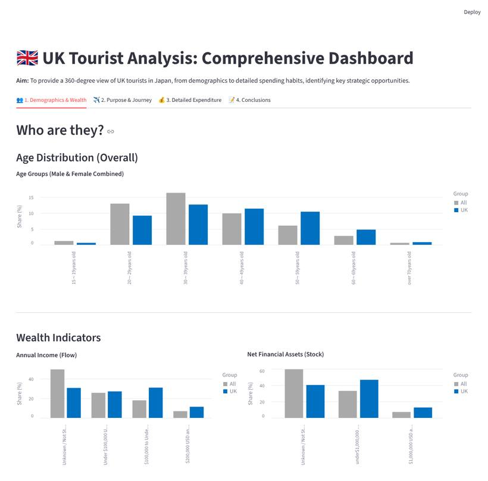
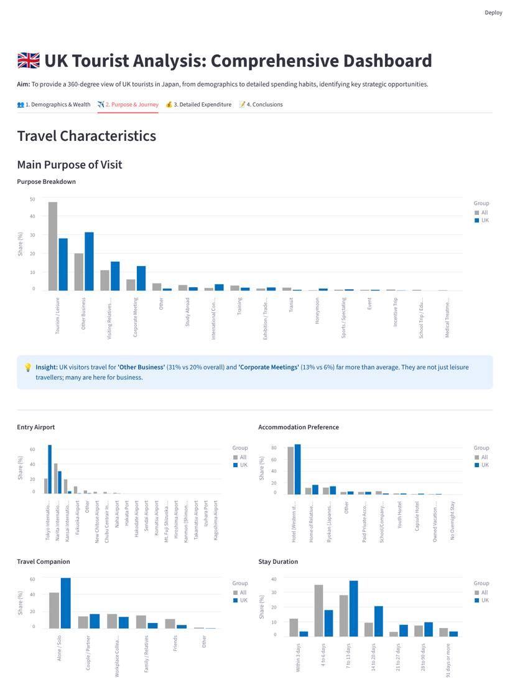
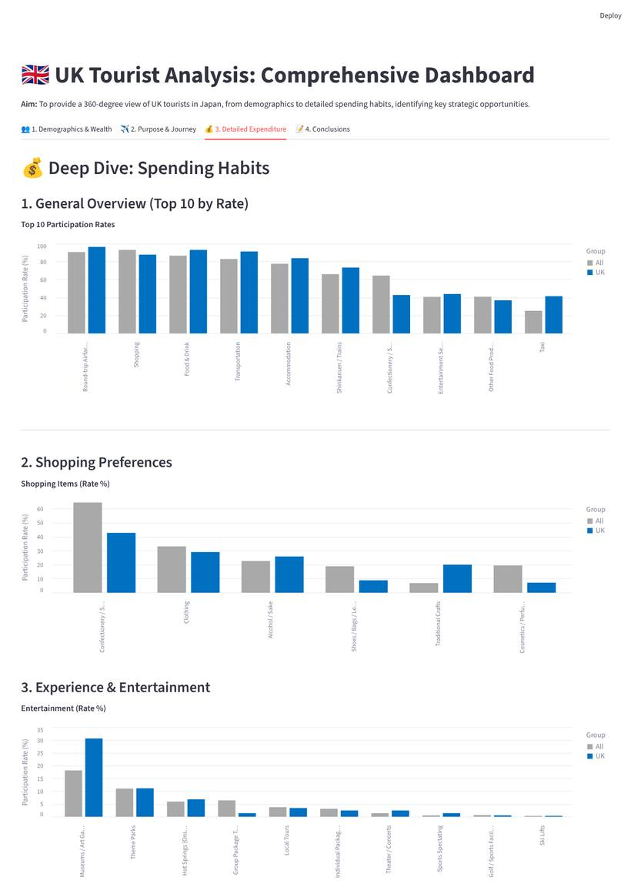
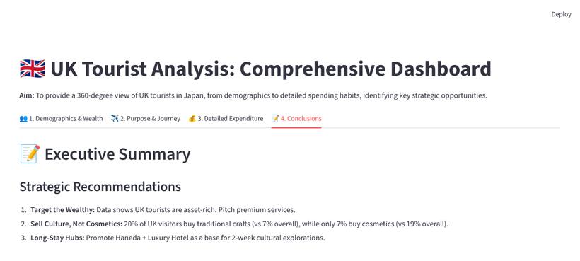

# 🇬🇧 UK Tourists in Japan — Spending & Behaviour Dashboard

**▶ Live demo:** https://uk-tourists-japan.streamlit.app

> Leeds Trinity University · COM6053 *Data Science for Business* — Assessment 1 (live dashboard), 2025–26
> Python / Streamlit / Altair

**TL;DR** — An interactive dashboard comparing UK visitors with all international visitors to Japan, using the Japan Tourism Agency's 2022 survey. UK visitors in the data are **wealthier, stay longer, travel more for business and enter mostly via Haneda**, and buy **traditional crafts rather than cosmetics** — pointing to premium, culture-focused, long-stay offers.



---

## 1. Business question / 目的

What makes UK visitors to Japan different from the average visitor, and what products or services should Japanese tourism businesses offer them?
イギリス人訪日客は全体と比べて何が違い、どんな商品・サービスが響くのか。

## 2. Approach / 分析手順

1. **Data selection** — extracted UK and all-visitor columns from the survey's annual tables (visitor profile; spending participation rate and unit price).
2. **Cleaning** — normalised column names, removed total rows, converted text numbers to numeric.
3. **Comparison** — UK share vs all-visitor share for each category.
4. **Communication** — four-tab Streamlit dashboard with grouped bar charts (UK vs All) and written insights.

## 3. Key findings / 主な発見 (UK vs all visitors, 2022)

| Theme | UK | All visitors | So what? |
|---|---:|---:|---|
| Household income ≥ $100k | **42%** | 25% | Wealthier → premium services |
| Net financial assets ≥ $1M | **13%** | 7% | |
| Stay of 7–20 days | **58%** | 37% | Long stays → multi-city / regional itineraries |
| Entry via Haneda | **66%** | 20% | Haneda as the gateway for UK campaigns |
| Business purpose (other business + corporate meeting) | **44%** | 26% | Business travellers → "bleisure" extensions |
| Buy traditional crafts | **20%** | 7% | Culture-led products |
| Buy cosmetics / perfume | 7% | **19%** | Cosmetics are not a UK hook |
| Use taxis | **41%** | 25% | Willingness to pay for convenience |

**Recommendations** — (1) target premium segments, (2) sell culture rather than cosmetics, (3) promote Haneda-based long-stay itineraries.

## 4. Dashboard

| Tab | Content |
|---|---|
| 1. Demographics & Wealth | Age, household income, net financial assets |
| 2. Purpose & Journey | Purpose of visit, entry airport, accommodation, companions, length of stay |
| 3. Detailed Expenditure | Top-10 spending items, shopping, experiences & entertainment |
| 4. Conclusions | Strategic recommendations |

<details><summary>More screenshots</summary>





</details>

## 5. Data / データ

| File | Description |
|---|---|
| `summary_data.csv` | Visitor profile shares (%) — all visitors vs UK |
| `expenditure_data.csv` | Spending participation rate (%) and unit price (¥) — all vs UK |
| `formatted data.xlsx` | Source tables after formatting |

**Source:** Japan Tourism Agency (観光庁), *Consumption Trend Survey for Foreigners Visiting Japan* (訪日外国人消費動向調査), annual tables for calendar year 2022 (estimates / 試算値), general visitors, all purposes. UK respondents: n = 583.
Aggregated public statistics, used for coursework with attribution (出典を明記して利用). This repository contains only the extracted aggregate tables.

## 6. How to run / 実行方法

```bash
pip install -r requirements.txt
streamlit run app.py
```

## 7. Limitations

- **2022 data:** collected while travel to Japan was affected by COVID-19. The publisher notes that the regional survey was cancelled in 2022 and that weighting for Jan–Jun differs from usual years, so the visitor mix (e.g. the high business share) may not reflect later years.
- Survey-based aggregate shares only; no individual-level data, so no statistical testing between groups.
- Income and asset questions have many "unknown / not stated" answers (UK 31–40%, all visitors 50–60%), so wealth comparisons are indicative.

**Tech:** Python · Streamlit · pandas · Altair
